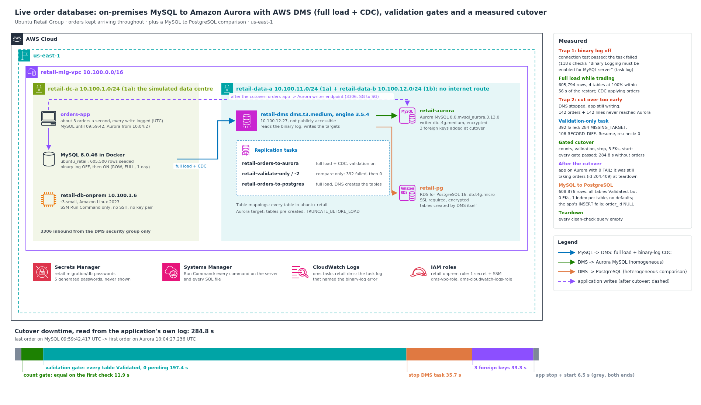

# Live Database Migration with AWS DMS: On-Premises MySQL to Aurora, Validated, with a Measured Cutover

Ubuntu Retail Group, a Johannesburg retailer, is in wave 2 of its move to AWS: the on-premises MySQL order database goes to Amazon Aurora. The last time they moved a database, the shop was offline for a weekend: export on Friday night, import on Saturday, test on Sunday, and hope. The board's rule this time:

> "Minutes of downtime, not a weekend. And prove nothing was lost."

I migrated a live order database (orders kept arriving the whole time) to Aurora MySQL with AWS Database Migration Service: a full copy plus continuous replication of every change (CDC), DMS's row-by-row validation, and a cutover that only moves forward when each gate is proven and puts the shop back on the old database if one isn't. I measured the downtime from the application's own log. Before the real cutover I ran the two mistakes I'd expect to see in a real migration on purpose and measured what they cost. Then I answered the board's second question ("what if we moved to PostgreSQL instead?") with evidence of what DMS does and doesn't carry across engines.

**Headline results**

| | Result | What it proves |
|---|---|---|
| **Cutover downtime** | **284.8 s** with no orders taken: last order on MySQL 09:59:42.417 UTC, first order on Aurora 10:04:27.236 UTC, read from the application's log | A weekend became under five minutes, with every gate passed |
| **Nothing lost** | All four tables `Validated` with 0 pending, 0 failed; Aurora row counts equal to the source (201,688 orders, 401,688 order lines) before the switch; 3 foreign keys added, so every reference checked | Proof by DMS's own row-by-row comparison, by counts, and by the database's integrity rules |
| **Trap 1: binary log off** | The connection test **passed**, then the task was **failed at the 118 s check**. The top-level error was generic; the task log named the cause: `Binary Logging must be enabled for MySQL server` | A connection test proves DMS can log in, not that CDC will work |
| **Trap 2: cutting over too early** | Stopping DMS while the shop was still trading left **142 orders and 142 order lines** that never reached Aurora. A validation-only task found **392 failed records** (284 missing, 108 different). After resuming DMS, the same check found **0** | The classic "the copy's done, switch over" mistake, measured, caught by validation and fixed |
| **The copy while trading** | 605,794 rows loaded (4 tables at 100% within 56 s of the restart) while the application kept writing; CDC applied the new orders and updates | The shop doesn't stop for the copy, only for the cutover |
| **MySQL to PostgreSQL** | DMS moved 608,876 rows and validated every table, but created **0 of 3 foreign keys, 1 index per table, no defaults, no auto-increment**. The application's normal INSERT failed: `null value in column "order_id"` | DMS moves data, not a schema. A different engine needs schema conversion first |

- **No password ever appeared on screen or in the repo.** Five passwords were generated into one Secrets Manager secret and read only inside `$( ... )` at the moment of use.
- **No SSH.** Every command on the server and every SQL file ran through SSM Run Command.
- Built, migrated, measured and torn down the same day, with a clean check that came back empty.



---

## The problem I was solving

> Move a live order database to Aurora MySQL with minutes of downtime, prove that nothing was lost, and have a way back at every step. Then show, with evidence, what changing engine to PostgreSQL would really involve.

This continues Ubuntu Retail's migration: `aws-migration-readiness-assessment` planned the waves, `aws-three-tier-web-app` built the web tier this database sits behind, and `aws-decoupled-order-pipeline` the order processing that writes to it.

---

## Four ideas the whole build depends on

1. **Full load + CDC is what makes downtime short.** DMS copies the tables while the shop trades, then reads every later change from MySQL's binary log and applies it to Aurora. The shop only stops for the final catch-up and switch, not for the copy.
2. **CDC needs the binary log, configured the right way.** For a MySQL source DMS needs binary logging on, `binlog_format=ROW`, `binlog_row_image=FULL`, and enough retention for DMS to keep up. MySQL 8.0 turns it on by default, but older servers (5.7 and earlier) often run without it, and some administrators switch it off to save disk. I switched it off on purpose for the drill.
3. **"The copy is done" isn't proof.** DMS validation compares source and target row by row. A validation-only task does the same comparison at a point in time, and records every difference in a table on the target.
4. **DMS moves data, not schemas.** Left to create the tables itself, it creates tables and primary keys (in some cases unique indexes). Secondary indexes, foreign keys, defaults and auto-increment are someone else's job: pre-created tables for the same engine, schema conversion for a different one.

---

## Architecture decisions

| Requirement | Decision | Why |
|---|---|---|
| Minutes of downtime, not a weekend | **Full load + CDC** task to Aurora MySQL | The copy happens while orders keep arriving |
| Same engine family, fewest surprises | **Aurora MySQL 3 (8.0-compatible)**, version pinned (`8.0.mysql_aurora.3.13.0`) | Matches MySQL 8.0 on the source; Aurora's 8.4-compatible line disables `mysql_native_password` by default, which the application and DMS users here use |
| Load fast, in any order | Aurora tables **pre-created without foreign keys**; `TRUNCATE_BEFORE_LOAD` | DMS loads tables in parallel, so a child row can arrive before its parent. The keys go on at cutover, and adding them checks every row |
| Keep indexes, defaults, ENUMs, AUTO_INCREMENT | **Pre-created schema** on Aurora instead of letting DMS create tables | DMS on its own creates tables and primary keys (in some cases unique indexes); on PostgreSQL here, the primary key only |
| Prove nothing was lost | **DMS validation** on the main task, **validation-only tasks** for point-in-time checks, plus **count gates** | Three independent checks: DMS's row comparison, counts, foreign keys |
| A way back at every step | **Gated cutover**: any gate not met in time restarts the app on the source | The source is never changed, so rolling back is restarting the app |
| Users don't migrate | The application user is **created on Aurora explicitly** before cutover | DMS copies data, not MySQL accounts |
| "What about PostgreSQL?" | A **DMS full load with DMS-created tables**, then measure what's missing | The gap list is the work **DMS Schema Conversion** would do in production ([ADR 0005](docs/adr/0005-schema-conversion-for-a-change-of-engine.md)) |
| No passwords anywhere | **One Secrets Manager secret**, five generated passwords, read only inside `$( ... )` | Nothing typed, nothing on screen, nothing in shell history |
| Nothing reachable from outside | Target databases and DMS in **private subnets with no internet route**; **SG-to-SG** rules one way only | MySQL accepts 3306 only from DMS; Aurora and PostgreSQL only from DMS and the app server |

Long-form reasoning is in [`docs/adr/`](docs/adr). The diagram uses the **official AWS Architecture Icons** and is generated from [`docs/diagram/build_architecture.py`](docs/diagram/build_architecture.py). The icon pack itself isn't committed: AWS licenses it for diagrams, not redistribution.

---

## How I built and measured it

**The "data centre".** One VPC, `retail-mig-vpc` 10.100.0.0/16. The on-premises server, `retail-db-onprem` (t3.small), sits in its own subnet and runs MySQL 8.0.46 in Docker with the `ubuntu_retail` database: 5,000 customers, 500 products, 200,000 orders and 400,000 order lines (605,500 rows), with ENUM columns, auto-increment keys, defaults, an `ON UPDATE` timestamp, secondary indexes and foreign keys. In production it would reach the VPC over the VPN from `aws-site-to-site-vpn-hybrid`.

**The shop.** `orders-app` is the order-taking application reduced to its database writes. Each loop inserts an order and an order line, sets the order total and marks a random older order SHIPPED. It ran at about **3 orders a second** (31 orders in 10.5 s, [`16`](docs/screenshots/16-step8-binlog-on-and-app-running.png)) and logs every write with a UTC timestamp, which is how the downtime is measured.

| Tool | What it does |
|---|---|
| [`source/userdata.sh.tpl`](source/userdata.sh.tpl) | The server's boot script: Docker, the PostgreSQL client, and two tools: `retail-db` (start MySQL with the binary log off or on, run SQL on any of the three databases, create users, count rows) and `orders-app` |
| [`scripts/secret.py`](scripts/secret.py) | Generates five 28-character passwords into one secret; prints only the ARN, or key names and lengths; `get` prints one password and is only ever used inside `$( ... )` |
| [`scripts/ssm_run.py`](scripts/ssm_run.py), [`scripts/ssm_sql.py`](scripts/ssm_sql.py) | Run a command, or a `.sql` file against the source, Aurora or PostgreSQL, on the server through SSM Run Command |
| [`scripts/dms_watch.py`](scripts/dms_watch.py) | Watches a DMS task until it stops, reaches CDC or is fully validated; prints DMS's own failure message |
| [`scripts/table_stats.py`](scripts/table_stats.py) | Per-table rows loaded, CDC inserts/updates and validation state, saved as CSV |
| [`scripts/cutover.py`](scripts/cutover.py) | `premature`: the trap drill. `run`: the gated cutover with rollback, timed from the application's log |
| [`dms/`](dms) | Table mappings and task settings: Aurora (full load + CDC, validation), validation-only, PostgreSQL |
| [`sql/`](sql) | Source schema, seed, Aurora schema without FKs, the FKs, validation-failure report, and the source/PostgreSQL inspections |

Every result table is in [`docs/results/`](docs/results).

---

## What I proved

| Test | Result | Evidence |
|---|---|---|
| Region checks | ✅ t3.small in 1a; dms.t3.medium in 1a–1f; Aurora `8.0.mysql_aurora.3.13.0`; db.t4g.medium for it in 1b, 1c, 1d, 1f (**not 1a**) | [`01`](docs/screenshots/01-step0-availability-and-aurora-version.png) |
| Network | ✅ VPC, three subnets, internet gateway, route table associated with the data-centre subnet; 4 security groups, 5 SG-to-SG rules | [`02`](docs/screenshots/02-step1-network.png), [`03`](docs/screenshots/03-step1-security-groups.png) |
| Passwords + roles | ✅ One secret, 5 keys of 28 characters (values never shown); server role reads only that secret + SSM; `dms-vpc-role` and `dms-cloudwatch-logs-role` created | [`04`](docs/screenshots/04-step2-secret-generated-never-shown.png), [`05`](docs/screenshots/05-step2-iam-roles.png) |
| Source, binary log off | ✅ MySQL 8.0.46, `log_bin` 0; seeded 5,000 / 500 / 200,000 / 400,000; `dms_user` (REPLICATION SLAVE, REPLICATION CLIENT, SELECT) and `orders_app`, both `mysql_native_password` | [`06`](docs/screenshots/06-step3-server-and-mysql-binlog-off.png), [`07`](docs/screenshots/07-step3-seed-and-users.png) |
| Targets + DMS | ✅ Aurora writer and PostgreSQL creating; replication instance dms.t3.medium, engine 3.5.4, 10.100.12.27, not public; Aurora available and encrypted | [`08`](docs/screenshots/08-step4-targets-creating.png)–[`10`](docs/screenshots/10-step5-aurora-available.png) |
| Aurora schema + endpoints | ✅ 4 tables pre-created on Aurora; connection tests `successful` for source, Aurora and PostgreSQL | [`11`](docs/screenshots/11-step6-aurora-schema.png), [`12`](docs/screenshots/12-step6-connection-tests.png) |
| **Trap 1: binary log off** | ✅ Task `failed` at the 118 s check: `Failed in resolving configuration ... FATAL_ERROR`. Task log: `Error Code [10001] : Binary Logging must be enabled for MySQL server [1020418]`, then `Errors in MySQL server validation` | [`13`](docs/screenshots/13-step7-trap1-task-failed.png)–[`15`](docs/screenshots/15-step7-trap1-task-log-cont.png) |
| The fix + the shop opens | ✅ `log_bin` 1, ROW, FULL, 86,400 s retention; `orders-app` running, 34 OK writes, 0 FAIL | [`16`](docs/screenshots/16-step8-binlog-on-and-app-running.png) |
| **Full load + CDC** | ✅ All 4 tables loaded; full load 605,794 rows (orders 200,147, order lines 400,147: the shop was already trading); CDC 526 inserts and 461 updates by then | [`17`](docs/screenshots/17-step8-full-load-and-cdc.png), [`full-load-tables.csv`](docs/results/full-load-tables.csv) |
| **Trap 2: premature cutover** | ✅ DMS stop requested at 09:39:16, confirmed stopped by 09:39:36, while the app kept writing until 09:40:05: source 201,002 orders, Aurora 200,860: **142 orders and 142 order lines missing** | [`18`](docs/screenshots/18-step9-trap2-premature-cutover.png), [`premature-cutover.csv`](docs/results/premature-cutover.csv) |
| Validation-only task | ✅ `Mismatched records`: orders 250 failed, order lines 142. Failures table: 142 + 142 `MISSING_TARGET`, 108 `RECORD_DIFF`; newest missing keys 201000–201002 | [`19`](docs/screenshots/19-step9-trap2-validation-only-task.png), [`20`](docs/screenshots/20-step9-trap2-validation-failures.png) |
| **Fixed and proven** | ✅ `resume-processing`: counts identical on both sides (201,002 / 401,002); a fresh validation-only task: every table `Validated`, 0 failed | [`21`](docs/screenshots/21-step9-resume-and-counts-match.png), [`22`](docs/screenshots/22-step9-revalidated-zero-failed.png) |
| **The cutover** | ✅ App stopped; counts equal on the first check (gate done 11.9 s after the stop); validation pending 475 → 0 in 197.4 s; task confirmed stopped within 35.7 s; `fk_items_order`, `fk_items_product`, `fk_orders_customer` added in 33.3 s; app started on Aurora. **Downtime 284.8 s** | [`23`](docs/screenshots/23-step10-cutover-gates.png), [`24`](docs/screenshots/24-step10-cutover-downtime.png), [`cutover-results.csv`](docs/results/cutover-results.csv) |
| Trading on Aurora | ✅ 30 s later: running, 0 FAIL, Aurora at 201,871 orders and climbing; final stats: every table `Validated`, 0 pending, 0 failed | [`25`](docs/screenshots/25-step10-app-on-aurora-final-stats.png), [`final-tables.csv`](docs/results/final-tables.csv) |
| **MySQL to PostgreSQL** | ✅ Full load 608,876 rows, every table `Validated`; then the gaps (next section) and `ERROR: null value in column "order_id" of relation "orders" violates not-null constraint` | [`26`](docs/screenshots/26-step11-postgres-full-load.png)–[`28`](docs/screenshots/28-step11-inspect-postgres.png) |
| Teardown | ✅ App stopped (last order 204,409 on Aurora); tasks, endpoints, replication instance, databases and server deleted; every clean-check query empty | [`29`](docs/screenshots/29-step12-teardown-dms.png)–[`31`](docs/screenshots/31-step12-clean-check.png) |

Walkthroughs: [`docs/trap-drills.md`](docs/trap-drills.md), [`docs/cutover-runbook.md`](docs/cutover-runbook.md), [`docs/mysql-to-postgresql.md`](docs/mysql-to-postgresql.md).

### What the numbers don't say

- **Most of the downtime was waiting for validation.** 197.4 of the 284.8 s went on the validation gate, which waited for DMS to validate the last changes (475 records pending when the gate started). The counts were already equal on the very first check. Whether a shorter cutover is acceptable (gate on counts, validate straight after) is a business decision about risk, not a technical one. [`docs/cutover-runbook.md`](docs/cutover-runbook.md) has the options.
- **This is a small database on small instances.** 600,000 rows at about 3 orders a second, one database connection at a time, the source in the same VPC. A larger, busier database over a real VPN will have a different full-load time and CDC lag. The method carries over; the numbers don't.
- **The PostgreSQL run was a full load only**, taken after the cutover when the source was quiet. It shows what DMS creates on a new engine; it isn't a rehearsal of a live PostgreSQL cutover.
- **DMS's CDC counters aren't a running total.** The final statistics show 828 CDC inserts on orders, yet the table grew from 200,147 to 201,688. The numbers fit exactly if the counters restart when the task is resumed (713 before the stop, 828 after), which is why my gates use row counts and validation, never these counters.
- **I didn't screenshot teardown Block C** (secret, IAM, network). The clean check shows the secret, the `retail-` roles and the VPC gone; it doesn't separately list the internet gateway, the instance profile or the two DMS service roles.

---

## What DMS carried to PostgreSQL, and what it didn't

The same source, loaded by DMS into RDS for PostgreSQL 16 with `DROP_AND_CREATE`, so DMS designed the tables itself:

| | MySQL source | PostgreSQL, tables created by DMS |
|---|---|---|
| Rows | 201,688 orders, 401,688 order lines | **identical, every table `Validated`** |
| Indexes (per table) | customers 2, order_items 3, orders 3, products 2 | **1 each** (the primary key only: no unique email/SKU, no secondary indexes) |
| Foreign keys | 3 | **0** |
| `orders.order_id` | `int unsigned`, `auto_increment` | `bigint`, **no default**: the app's INSERT fails |
| `orders.status` | `enum('NEW','PAID','SHIPPED','CANCELLED')`, default `NEW` | `character varying(9)`, no default, any text up to 9 characters |
| `orders.total_zar` | `decimal(12,2)`, default `0.00` | `numeric` (the scale of 2 came across: `0` is stored as `0.00`), no default |
| `created_at`, `updated_at` | `datetime(3)`, default `CURRENT_TIMESTAMP(3)`, `ON UPDATE` | `timestamp without time zone`, no defaults, no automatic update |

`int unsigned` became `bigint` (an unsigned 32-bit value can exceed PostgreSQL's signed `integer`), and the ENUM became a 9-character string ("CANCELLED" is the longest value). Every row arrived. The database those rows sit in would not run the application. Full comparison: [`docs/mysql-to-postgresql.md`](docs/mysql-to-postgresql.md).

---

## Debugging along the way

- **The top-level error wasn't the cause.** The failed task said only `Failed in resolving configuration ... FATAL_ERROR`. The cause was in the task's CloudWatch log. My first log search returned nothing: CloudWatch Logs filter patterns are case-sensitive, and DMS writes "Binary Logging". I searched the log with `grep -i` instead and found it.
- **A passing connection test, then a failing task.** The source endpoint tested `successful` with the binary log off. The test checks login and read access; CDC prerequisites are checked when the task starts. DMS premigration assessments are the place to catch source settings like this before a task ever runs.
- **My `--query` printed `None`, then the answer twice.** With text output, the AWS CLI applies `--query` to each page of results separately, and this list came back in pages: one page had no dms.t3.medium entry (`None`), two did. The answer was right; the output shape was a paging artefact.
- **db.t4g.medium for this Aurora version isn't offered in us-east-1a.** The DB subnet group spans 1a and 1b, so 1b was the only subnet the writer could use. Fine for one writer; for a reader in a second AZ, the subnets would need to be in two AZs that both offer the class.
- **The app's log was one order short of the database.** In the premature drill the last logged order was 201,001, but the source's newest order was 201,002: the app was stopped between its INSERT and its log line. That's why the gates compare the databases, not the application's log.

Full notes: [`docs/debugging-journey.md`](docs/debugging-journey.md).

---

## Cost

| Item | Rate (approx. list price, us-east-1) | This build |
|---|---|---|
| DMS replication instance dms.t3.medium, 50 GB | ~US$0.08 per hour | a few hours |
| Aurora MySQL writer db.t4g.medium + storage and I/O | ~US$0.07 per hour + usage | a few hours |
| RDS for PostgreSQL db.t4g.micro, 20 GB gp3 | ~US$0.02 per hour | a few hours |
| EC2 t3.small + public IPv4 address | ~US$0.02 + US$0.005 per hour | a few hours |
| Secrets Manager, 1 secret | US$0.40 per month, prorated | cents |
| **Total (estimate)** | | **about US$1–2**; Cost Explorer figure for 6 Oct to be added |

Left running, the same set is about US$5 a day, which is why teardown was part of the same session. Details: [`docs/cost-model.md`](docs/cost-model.md).

---

## Compliance & frameworks

The order database holds customers' personal information (names, email addresses, provinces) and the company's sales record. A migration is a change to where that data lives and to the system that keeps it accurate.

- **POPIA (South Africa)**
  - **Section 19, security safeguards (integrity and confidentiality)**: integrity proven by validation, counts and foreign keys; confidentiality by private subnets, SG-to-SG rules, encrypted targets and generated passwords nobody saw.
  - **Section 72, transborder flows**: this lab ran in us-east-1 with synthetic data. For Ubuntu Retail's real customers I'd target af-south-1 (Cape Town), or document the Section 72 basis before moving personal information abroad.
- **ISO/IEC 27001:2022 Annex A**
  - **A.8.32 Change management**: the cutover is a gated runbook with a tested rollback, and the trap drills tested the failure modes first.
  - **A.8.24 Use of cryptography**: Aurora and PostgreSQL encrypted at rest; DMS to PostgreSQL over SSL.
  - **A.5.17 Authentication information** and **A.8.5 Secure authentication**: passwords generated into Secrets Manager, never typed or displayed.
  - **A.8.2 Privileged access rights**: the server's role reads one secret and uses SSM, nothing else; no SSH.
  - **A.8.15 Logging**: DMS task logs in CloudWatch, and an application log with a timestamp for every write.
- **NIST SP 800-53 Rev. 5**
  - **SI-7 Software, firmware and information integrity**: row-by-row validation and referential checks before the switch.
  - **CM-3 Configuration change control**: the change was tested (the trap drills) and validated before it went live, with automatic rollback to the untouched source.
  - **IA-5 Authenticator management**, **AC-6 Least privilege**, **SC-7 Boundary protection**, **SC-28 Protection of information at rest** (encrypted targets), **AU-12 Audit record generation**.
  - **SC-8 Transmission confidentiality** is only partly covered: the PostgreSQL leg required SSL, the MySQL and Aurora legs inside the VPC didn't. In production I'd require TLS on every endpoint.
- **NIST Cybersecurity Framework 2.0**: **PR.DS-01** (confidentiality and integrity of data at rest), **PR.DS-02** (data in transit, with the same TLS gap as SC-8), **PR.PS-01** (configuration management practices applied).
- **SOC 2 (AICPA Trust Services Criteria)**: **CC8.1** change management, and the **Processing Integrity** criteria (data complete and accurate after the move), which is what the validation evidence answers.

PCI DSS isn't in scope: this database holds orders and totals, not card data.

---

## Repo layout

```
.
├── README.md
├── env.sh.example                    # copy to env.sh (git-ignored); saved IDs + the save() helper
├── source/userdata.sh.tpl            # the on-prem server: Docker MySQL 8.0, retail-db, orders-app
├── sql/
│   ├── source-schema.sql             # the order database as it runs on-premises
│   ├── seed.sql                      # 605,500 deterministic rows, generated inside MySQL
│   ├── target-schema.sql             # Aurora: same tables and indexes, no foreign keys
│   ├── add-foreign-keys.sql          # the cutover's integrity step
│   ├── validation-failures.sql       # what a validation-only task found
│   ├── inspect-source.sql            # indexes, FKs, column types and defaults on MySQL
│   └── inspect-postgres.sql          # the same on PostgreSQL, plus the app's INSERT
├── dms/                              # table mappings + task settings (Aurora, validation-only, PostgreSQL)
├── scripts/
│   ├── secret.py                     # passwords generated into one secret, never shown
│   ├── ssm_run.py, ssm_sql.py        # commands and SQL on the server via SSM Run Command
│   ├── dms_watch.py                  # watch a task until stopped / CDC / validated
│   ├── table_stats.py                # per-table statistics -> CSV
│   ├── cutover.py                    # premature-cutover drill + the gated cutover
│   └── render.py, kit_aws.py         # placeholder filling + shared helper
├── policies/                         # trust policies + the server's read-one-secret policy
└── docs/
    ├── architecture.png / .svg       # official AWS Architecture Icons
    ├── diagram/                      # build_architecture.py + awsdiag.py
    ├── results/                      # every table-statistics, drill and cutover CSV
    ├── trap-drills.md
    ├── cutover-runbook.md
    ├── mysql-to-postgresql.md
    ├── debugging-journey.md
    ├── cost-model.md
    ├── teardown.md
    ├── adr/                          # 7 architecture decision records
    └── screenshots/                  # 31 build, test and teardown screenshots, in order
```

> **No account IDs or passwords are committed.** Account IDs are masked in the screenshots; templates use `@@NAME@@` placeholders filled at build time. There is no `Deny` statement anywhere, and nothing has deletion protection, so teardown can't lock anyone out.

---

## Reproduce it

From WSL, in `us-east-1`, as an administrator. Every value is saved with `save NAME "$(command)"` into `env.sh`.

1. From the repo folder: `cp env.sh.example env.sh && mkdir -p build && source ./env.sh`.
2. Check offerings and pin versions: save `AURORA_VERSION` (latest `8.0.mysql_aurora.3.*`) and `PG_VERSION` (latest `16.*`); check where db.t4g.medium is offered.
3. Network: VPC 10.100.0.0/16; `retail-dc-a` 10.100.1.0/24 (1a) with an internet route; `retail-data-a` 10.100.11.0/24 (1a) and `retail-data-b` 10.100.12.0/24 (1b) with none. Security groups: MySQL 3306 from DMS; Aurora 3306 and PostgreSQL 5432 from DMS and the server.
4. `python3 scripts/secret.py create retail-migration/db-passwords`; render `policies/source-host-perms.json.tpl`; the server role (that policy + `AmazonSSMManagedInstanceCore`) and profile; `dms-vpc-role` and `dms-cloudwatch-logs-role` if the account doesn't have them.
5. Render `source/userdata.sh.tpl`, launch `retail-db-onprem` (t3.small, AL2023), then `ssm_run.py sh "$SRC_ID" "cloud-init status --wait && retail-db mysql-start nobinlog"`; `ssm_sql.py source sql/source-schema.sql` and `sql/seed.sql`; `retail-db users-source`.
6. DB subnet group, Aurora cluster + db.t4g.medium writer, PostgreSQL db.t4g.micro; DMS subnet group + dms.t3.medium replication instance (private). Save `AURORA_HOST`, `PG_HOST`; `retail-db set aurora|pg`.
7. `ssm_sql.py aurora sql/target-schema.sql`; three endpoints (PostgreSQL with `--ssl-mode require`); test connections.
8. Trap 1: create the `retail-orders-to-aurora` task (migration type `full-load-and-cdc`) with `dms/task-settings-aurora.json`, start it, `dms_watch.py --until stopped`, read the task log.
9. `retail-db mysql-start binlog`; `orders-app start source`; restart the task with `reload-target`; `dms_watch.py --until cdc`; `table_stats.py`.
10. Trap 2: `cutover.py premature`; a validation-only task (`dms/task-settings-validate-only.json`) and `sql/validation-failures.sql`; `resume-processing`; a second validation-only task; `orders-app start source`.
11. `retail-db users-aurora`, then `cutover.py run`.
12. PostgreSQL: a `full-load` task with `dms/task-settings-postgres.json`; `ssm_sql.py source sql/inspect-source.sql` and `ssm_sql.py pg sql/inspect-postgres.sql` (its last statement is expected to fail).
13. Teardown the same day: [`docs/teardown.md`](docs/teardown.md).

---

## What this connects to

- `aws-migration-readiness-assessment`: the wave plan that put this database in wave 2.
- `aws-three-tier-web-app` and `aws-decoupled-order-pipeline`: the web tier and order processing that write to this database.
- `aws-site-to-site-vpn-hybrid`: the VPN a real data centre would use to reach the replication instance.
- `aws-aurora-ha-architecture`: readers and failover for the Aurora cluster this migration lands on.
- `aws-hybrid-storage-transfer`: the file-data side of the same kind of move (DataSync and Storage Gateway), where this project is the database side.
